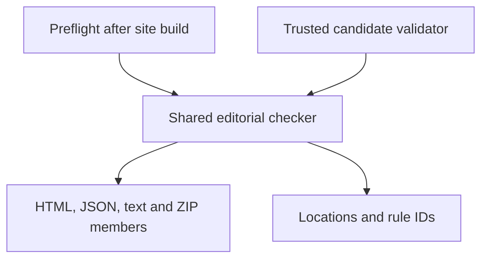
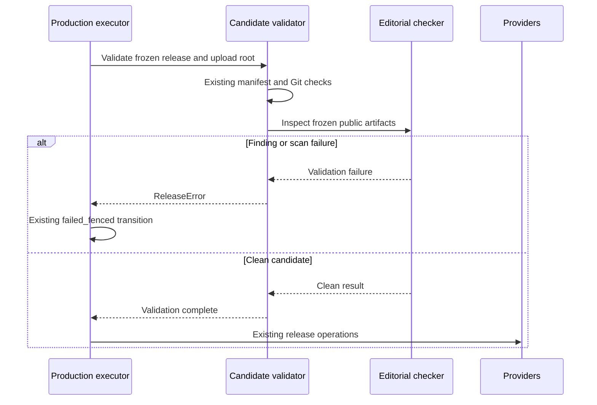

# Reject editorial placeholders before publication - Plan

## Goal Capsule

- **Objective:** Students receive public practicum materials without unresolved editorial markers such as “WHAT DOES ZOPA STAND FOR.”
- **Means:** One deterministic checker, used by preflight and by the trusted production candidate validator (KTD1–KTD3).
- **Authority:** The supplied `so-3` mandate and campaign standing rules govern this item. The chief repo's `docs/plans/2026-10-26-0705-feat-codex-drawdown-campaign-plan.md`, Goal Capsule and campaign R11, R15, R16, R17, R19, R20, remain the upstream authority; see the source-availability limitation below.
- **Execution boundary:** This item is one expansion on `drawdown/so-3`. This stage commits the plan only. A later build stage implements and verifies it locally; the controller pushes and opens the PR, and the campaign merge gate owns merge and delivery.
- **Stop conditions:** Preserve the restrictions in R6–R7. A bad or unreadable publication candidate stops publication under R4; it does not authorize content edits outside this item or a bypass deployment.

---

## Product Contract

### Summary

Add a deterministic editorial-placeholder check to the public artifact and enforce it before the existing production release executor can contact either deployment provider. Give developers the same check in preflight, with useful locations and tests that prove rejection.

### Problem Frame

At inspected commit `09932f7`, the mandate's example remains in `data/curriculum/templates/ssnp.md` and its generated `site/platform/templates/index.html` page. The site builder checks links, instructor leaks, durable markers and history leaks, but has no editorial-placeholder check. The production candidate validator checks the manifest and Git identity without inspecting editorial content. A valid release can therefore carry an unresolved author question into student materials.

### Requirements

**Publication behavior**

- R1. Reject a public candidate containing recognized unresolved editorial markers, including the mandate's ZOPA question; apply the deterministic policy in the Planning Contract.
- R2. Preserve legitimate instructional questions, defined acronyms, form fields, signature blanks and checklists.
- R3. Report each failure with a stable rule identifier and a relative artifact location, without echoing surrounding matter text.
- R4. Scan the exact authorized candidate before any new provider deployment or candidate reactivation; a finding or incomplete scan must fail through the existing release-fencing path.

**Verification and campaign boundaries**

- R5. Add regression tests for detection and the actual publication boundary, while preserving every existing test and assertion (campaign R15–R16).
- R6. Limit changes to `so-3`: no apply-daemon or timer changes, alternative deploy path, migration, data rewrite, package release or outside service.
- R7. Keep the work locally committed on `drawdown/so-3`, with public-safe artifacts and no credentials, remote setup, spend, destructive deletion or sends (campaign R11, R17, R19–R20 as supplied).

### Key Decisions

- **Deliver the expansion through campaign guardrails.** (session-settled: user-directed — chosen over holding expansions for personal review: the campaign's checks and merge gate own delivery.) Governs R5–R7.

### Acceptance Examples

- AE1. Covers R1, R3–R4. An otherwise valid candidate contains the ZOPA question only in a student ZIP member. Validation identifies that member, fences the attempt, and neither provider is called.
- AE2. Covers R2. A clean candidate contains a question about negotiation, a correctly defined ZOPA acronym, `[Client name]`, blank signature lines and checkbox prompts. The editorial check passes.
- AE3. Covers R4. The ambient working tree is clean but the authorized candidate is contaminated, or vice versa. Only the frozen candidate determines the result.
- AE4. Covers R4. A scoped JSON file cannot be parsed, or a student ZIP cannot be read. Validation fails; an empty or skipped scan is never reported as clean.

### Scope Boundaries

The active scope is a publication guard, its tests and its developer/operator documentation. No public copy, layout, editor controls or Worker endpoint changes are planned.

Considered and not built: semantic review of arbitrary prose, fuzzy uppercase-question detection, a configurable suppression list, a new approval screen and binary-document extraction. The finite policy is reviewable and sufficient for the evidenced text/ZIP publication surface. A new confirmed marker family or a new supported publication format would justify revisiting that boundary.

#### Deferred to Follow-Up Work

- `so-1` owns the existing editorial corrections, including the SSNP note. Do not duplicate those edits here.
- `so-2` owns jurisdiction/caption checks; `so-4` owns live accessibility verification; `so-5` owns CI expansion.

---

## Planning Contract

### Verified Starting State and Source Availability

The branch was clean at `09932f7`; no test or build ran during planning. No repository `AGENTS.md`, `CLAUDE.md`, strategy document or existing `so-3` plan was present. The supplied campaign instructions remain operative.

The named chief-repo campaign plan and `docs/handoffs/2026-10-23-editorial-review-batch-20261023T172555Z.md` were unavailable in this clone and the accessible local source locations. Their contents have not been verified. The controller must reconcile the cited Goal Capsule/R-IDs and handoff against this plan before build handoff; this is a source-availability task, not a request for Damien's time. The available `docs/plans/2026-10-24-0640-fix-editor-overlay-a11y-plan.md` was read as a scope constraint; its work stays in `so-4`.

The current release trace is:

- `tools/preflight.sh` runs the site build before its Python and Node suites.
- `tools/apply_suggestions.py::SubprocessPipeline.build` also invokes the checked site build for DEV edits. Reusing that gate for editorial rejection would change the editing workflow.
- `tools/prod_release_daemon.py::main` materializes the authorized SHA and resolves the configured Pages artifact inside that checkout.
- `tools/prod_release_executor.py::CandidateValidator` verifies manifest bindings, ancestry, tree identity and checkout cleanliness. `ProductionExecutor.run_once` invokes it before deployments or recorded-candidate reactivation, and fences validator failures.
- `restore_recorded_base` is a separate recovery path. This item leaves exact-pair restoration unchanged.

### Assumptions

These are bounded engineering defaults, not additional user-approved product scope.

1. **Publication means the normal production release.** DEV authoring may retain unresolved draft notes. Preflight provides early feedback; it does not change DEV apply eligibility.
2. **Recognized markers are a closed set.** Reject the case-insensitive ZOPA question with optional terminal question mark; word-bounded `TODO:` and `FIXME:` directives; and bracketed `[TODO]`, `[FIXME]`, `[TBD]` markers, including their colon-and-instruction forms. Fold whitespace and decode the carrier before matching. Bare `TBD`, `XXX`, “placeholder,” arbitrary bracketed fields and generic questions are not failures.
3. **Current public carriers define coverage.** Inspect HTML/HTM readable text and reader-facing attributes, JSON string values, Markdown, text and CSV fields, plus those formats inside student ZIPs. Static inspection found no current PDF publication output. JavaScript, CSS, binary assets and private history outside the upload tree are not prose-scanner inputs.
4. **A clean live-corpus result depends on `so-1`.** Until its correction is in the candidate, the known SSNP note should fail. Synthetic fixtures let this item be implemented and tested independently.

### Key Technical Decisions

- KTD1. **Use one standard-library checker in `tools/check_editorial_placeholders.py`.** Expose reusable scanning logic and a local CLI, with the marker policy from Assumption 2. The artifact root is an explicit input; scanning never falls back to the ambient repository. This serves R1–R3 without a new dependency.
- KTD2. **Keep preflight separate from the shared DEV build gate.** Add a named check after site generation in `tools/preflight.sh`, leaving `tools/build_site.py --check`, `SubprocessPipeline` and the apply daemon unchanged. This follows the publication boundary in Assumption 1 and R6.
- KTD3. **Enforce R4 inside the trusted candidate validator.** Pass the actual Pages upload root from the production daemon into `CandidateValidator`. Run the current checker's implementation against that frozen artifact after the existing identity checks and inside `ProductionExecutor`'s existing error/fencing path. Do not execute a checker supplied by an older candidate, rebuild the frozen tree, or add a skip flag. Preflight alone cannot protect an older or separately prepared candidate.
- KTD4. **Normalize within content boundaries.** Reuse the stdlib HTML parsing approach in `tools/verify_pitch.py`, retaining line information. Join inline text but keep separate HTML blocks, JSON values and CSV fields independent. Include disclosure content and readable attributes such as accessible labels, titles, alternative text and form hints; exclude HTML comments and script/style bodies. Decode JSON escapes, render supported Markdown inline syntax consistently with existing rendering, and preserve a source location for each finding. This prevents both markup evasion and phrases manufactured by joining unrelated fields.
- KTD5. **Use the existing archive and diagnostic conventions.** Follow `tools/build_site.py::check_no_instructor_leaks` for ZIP-member traversal and `archive.zip!member.md` locations without changing that checker. Sort findings deterministically. Report path plus line or JSON location and rule ID, never a prose excerpt. Missing or empty roots, unreadable scoped files, malformed structured carriers and symlinked scan inputs fail closed without following links outside the artifact.

### High-Level Technical Design

The same scanner serves two entry points; only the production validator authorizes progression toward providers.

The release guard follows existing authority checks and uses existing failure handling.

### Risks and Dependencies

- **Known-content dependency:** `so-1` must reach the candidate before the clean-corpus gate can pass. Do not add an exception for the existing note or silently remove it in this branch.
- **Historical candidates:** Their bundled tools may predate this change. KTD3 ensures the trusted release checkout supplies the policy while the authorized checkout supplies the bytes.
- **False positives:** Assumptions 2–3 bound the classifier. Pair every marker family with legitimate teaching/template fixtures; do not expand the rules merely to satisfy an unrelated editorial concern.
- **Existing fixtures:** Some release-validator tests create small repositories without a public site. Add valid minimal artifacts to those fixtures when needed, preserving their original assertions and failure coverage.
- **Operational availability:** This clone has no remote or authenticated services and denies Unix sockets. Keep integration tests local and inject provider transport. A sandbox/browser limitation is reported as unverified evidence, not a passing check.

---

## Implementation Units

### U1. Detect editorial markers in the public artifact

**Goal:** Produce deterministic, actionable findings from the supported publication carriers.

**Requirements:** R1–R3, R5–R6; AE1–AE2. **Dependencies:** None.

**Files:** Create `tools/check_editorial_placeholders.py` and `tools/tests/test_editorial_placeholders.py`.

**Approach:** Implement KTD1, KTD4–KTD5 with the policy in Assumptions 2–3. Use fixture builders from `tools/tests/test_coverage_build_site.py` and `tools/tests/test_coverage_student_archives.py` to connect real generated bytes with the scanner. Use `unittest.TestCase` for the core cases so they also run under the existing pytest suite.

**Execution note:** Start with a failing canary on generated output. The checker must prove it can reject, as required by `docs/solutions/editor/2026-07-28-checks-that-cannot-fail.md`.

**Test scenarios:**

1. The exact ZOPA note, case changes, repeated/newline/nonbreaking whitespace, HTML entities and inline emphasis yield the same rule identifier and useful location.
2. Each explicit marker family rejects in HTML and plain text, including Markdown emphasis; bare acronyms and ordinary words remain valid.
3. Covers AE2. Realistic synthetic form blanks, checklists, bracketed field names, placeholder attributes with valid hints and instructional questions pass.
4. JSON escapes decode before matching; separate JSON values, CSV fields and HTML paragraphs cannot combine into a false phrase.
5. A marker in readable HTML attributes or a closed disclosure rejects; comments and script/style code are excluded.
6. Covers AE1. A marker only in an actual generated student ZIP's Markdown or JSON member rejects with the archive/member location. A clean archive passes.
7. Covers AE4. Missing/empty roots, failed reads, invalid JSON, malformed ZIPs and symlinked scan inputs fail without a false clean result or out-of-root read.
8. Multiple findings have stable ordering and no source excerpts. Repeated scans leave artifact bytes unchanged.

**Verification:** The new core suite runs in unittest and pytest; real builder/archive output reaches the actual checker. No fixture mutates canonical repository data.

### U2. Enforce rejection at the production boundary

**Goal:** Make a contaminated authorized candidate unable to reach provider operations.

**Requirements:** R1, R3–R6; AE1, AE3–AE4. **Dependencies:** U1.

**Files:** Modify `tools/prod_release_executor.py`, `tools/prod_release_daemon.py`, `tools/tests/test_prod_release_executor.py`, `tools/tests/test_prod_release_daemon.py`, and `tools/tests/test_coverage_prod_release_executor.py` where existing fixtures require valid artifact inputs.

**Approach:** Apply KTD3 inside the existing candidate-validator call. Preserve manifest checks, ledger payload shape, authority requirements, canary/routine behavior and the recorded-base restore path. Use the real checker and validator; fake only provider and ledger transport in boundary tests. Follow `docs/solutions/worker/2026-09-27-test-real-producer-consumer-bytes.md`.

**Test scenarios:**

1. Covers AE1. A correctly bound candidate with a planted marker raises the existing release failure, records `failed_fenced`, and makes zero provider upload, deploy or candidate-reactivation calls.
2. A clean candidate reaches the existing provider sequence; existing manifest/ancestry/tree failures still reject before publication.
3. Covers AE3. A clean ambient tree cannot mask a contaminated frozen artifact, and unrelated draft content in ambient HEAD cannot block a clean frozen candidate.
4. An older candidate lacking the new script is still checked by the trusted release code.
5. Both routine and canary daemon paths pass the exact resolved Pages artifact root to validation; an alternate in-checkout artifact directory is scanned rather than an assumed `site/platform/` path.
6. Covers AE4. Scanner parse/read errors fence the attempt and never trigger provider calls. Diagnostics and ledger events contain no surrounding content.
7. An attempt with recorded candidate artifacts is checked before reactivation; the existing exact recorded-base restoration path remains usable.
8. The scanner does not write files, rebuild the candidate, or change its Git tree or manifest.

**Verification:** Boundary tests demonstrate rejection by the real checker and success for a clean candidate, while all existing release tests retain their assertions.

### U3. Add preflight feedback and publication guidance

**Goal:** Let developers catch the same defect before a candidate is authorized.

**Requirements:** R1–R3, R5–R7. **Dependencies:** U1–U2.

**Files:** Modify `tools/preflight.sh`, `README.md`, and `docs/prod-release-operations.md`; create `tools/tests/test_editorial_placeholder_preflight.py`.

**Approach:** Add KTD2's named check and document its scope, findings, local invocation and the `so-1` content dependency. Preserve existing preflight checks and exit aggregation. Exercise preflight using a disposable fixture harness that keeps the real checker while replacing unrelated expensive/network commands.

**Test scenarios:**

1. A marker introduced into the fixture's generated artifact makes preflight exit nonzero and identify the editorial check; a clean fixture succeeds.
2. The check runs after generation and remains active in the existing `--no-browser` mode. A failed build cannot produce a successful overall preflight from stale output.
3. Existing checks remain present and their failures still propagate; success is determined by exit status, not a report-shaped text match.
4. Default generation and the checked build retain their current behavior for DEV drafts; no new dependency is introduced into `SubprocessPipeline` or the apply daemon.

**Verification:** The preflight wiring test runs without services, credentials or browser sockets. Documentation identifies the authoritative production gate and offers no bypass.

---

## Verification Contract

All execution evidence is collected in the build stage. Planning established source facts only.

| Check | Required evidence |
|---|---|
| New core unittest module | `python3 -m unittest tools.tests.test_editorial_placeholders` proves matching, negative controls, carrier coverage and scan failures. |
| Python suite | `python3 -m pytest tools/tests/ -q` includes the new publication/preflight tests; preserve existing assertions and report unrelated baseline failures separately. |
| Node tool tests | `node --test tools/tests/*.test.js` remains passing. |
| Worker tests | Existing `node --test test/*.test.js` from `app/worker/` remains passing after the documented generated prerequisites. |
| Real publication canary | Real generated bytes, real scanner and real validator reject a synthetic candidate before mocked providers; the clean control succeeds. |
| Existing site build and preflight | Generate the documented dependencies, then verify the normal build and preflight. Record the intentional known-note failure if `so-1` is absent; a fully green real-corpus result requires the corrected candidate. |
| Frontend evidence | No frontend change is planned. If implementation changes a rendered page, retain the existing accessibility checks and commit a Playwright screenshot under `docs/plans/evidence/`, reporting its path as `SCREENSHOT: <path>` (campaign R15–R16). |

Do not run the legacy taxonomy generator; its identity-rewrite hazard is documented in `docs/solutions/orchestration/2026-10-05-fresh-worktree-generated-artifacts-and-legacy-generators.md`. Preserve the repo's normal generated-artifact prerequisites without committing unrelated output.

---

## Definition of Done

- R1–R7 are implemented with the U1–U3 test evidence, including positive and negative controls on actual publication carriers.
- The bad-candidate integration test fails before the change and passes after it; a clean candidate still follows the existing release path.
- The controller has reconciled the unavailable authority sources, and the final real-corpus result names whether the separate `so-1` dependency is present. A remaining known-note failure is not claimed as a green release.
- The diff contains only this guard, its tests and documentation. No abandoned experimental implementation remains; existing tests are not deleted or weakened.
- The local commit is ready for the controller's publication and campaign review process, with no deployment or production enablement performed by this lane.
