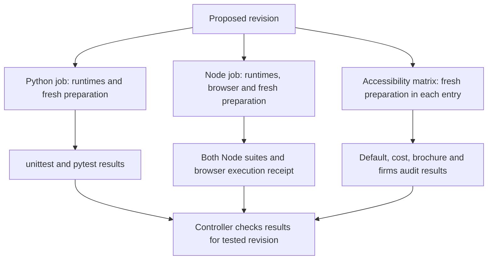

# so-5 Test and Accessibility CI - Plan

## Goal Capsule

- **Objective:** Maintainers can see whether a proposed change passes the project's existing automated correctness and accessibility checks before it merges.
- **Means:** Add focused GitHub Actions checks backed by reproducible local test prerequisites (KTD1-KTD5).
- **Authority:** The controller's `so-5` mandate and standing drawdown rules govern this item. The campaign authority is the chief repository's `docs/plans/2026-10-26-0705-feat-codex-drawdown-campaign-plan.md`, specifically its Goal Capsule and R11, R15, R16, R17, R19, and R20. Those source sections were unavailable in this isolated clone; the bindings below use the rules supplied with the mandate, not an independently verified reading of the chief plan.
- **Execution boundary:** This stage produces and locally commits this plan only on `drawdown/so-5`. A later build stage executes the plan with `lfg`; the controller scans, pushes, and opens the PR, and the campaign gate handles review and merge. Do not add a remote or seek credentials. Campaign model assignments and review gates remain unchanged.
- **Stop conditions:** Preserve R6-R8. A missing runtime capability is an unverified check, never a pass. The controller must reconcile the unavailable authority source before authorizing execution; this requires no decision from Damien.

---

## Product Contract

### Summary

Run the existing Python tests, both Node test suites, and the existing accessibility sweeps automatically for proposed changes. Preserve failures and diagnostic evidence so the controller can make a truthful merge decision.

### Problem Frame

At starting commit `09932f7`, there is no tracked CI workflow or dependency manifest. Verification lives in local tools with generated prerequisites and machine-specific browser fallbacks. Earlier accessibility fixes have already merged, so the mandate catalog is not current test evidence.

### Requirements

**Test coverage**

- R1. CI runs native unittest discovery and the full existing pytest suite under `tools/tests/`; module-level pytest tests must remain covered.
- R2. CI runs both existing Node test globs under `tools/tests/` and `app/worker/test/`. The existing assessment-review browser regression must execute rather than silently skip for missing browser tooling.
- R3. CI runs the existing default accessibility sweep and the supplemental cost-per-credit, brochure, and firms sweeps. Preserve the audit's FAIL/WARN semantics and the accepted-warning policy in `docs/uat/accessibility-conformance.md`.

**Reproducibility and evidence**

- R4. Each check prepares its own fresh checkout using declared runtimes and test dependencies. No check depends on a developer's generated files, browser installation, login, or warm cache.
- R5. A failing suite, prerequisite, browser startup, or audit makes its check fail. Diagnostics remain available after failure; no missing or skipped audit counts as success.

**Campaign boundaries**

- R6. Work only `so-5` on its named branch. Leave the apply daemon, timers, publishing paths, editorial content, and frontend behavior unchanged. No migration, data rewrite, package release, outside service, spend, credential change, message sending, destructive deletion, or force-push is authorized by this item. Preserve the campaign's restricted-file rule (campaign R11, R15-R17 as supplied).
- R7. The lane commits locally; publication and merge stay with the controller and campaign gate (campaign R15, R19 as supplied). Repository protection and account settings remain unchanged.
- R8. Preserve every existing test and assertion. Add tests for any new executable tooling and retain truthful results, including environment-related skips. Unrelated failures and work requiring a user decision are reported without weakening a gate (campaign R16, R20 as supplied).

### Key Decisions

- **Deliver durable hygiene within the assigned item.** Governs R6. (session-settled: user-directed — chosen over speculative features: the campaign explicitly prioritizes hygiene once planned work and worthwhile expansions run out.)
- **Use the controller's publication boundary.** Governs R7. This lane's specific local-only instruction controls over general standing publication authorization.

### Scope Boundaries

This is CI tooling and documentation work. It does not close the live editor-overlay verification item `so-4` or implement the editorial checks in `so-1` through `so-3`.

The full `tools/preflight.sh` remains available for release verification. Moving its live probes, broader browser journeys, or deployment gates into CI is outside this item; evidence that one is necessary to run the named suites would justify a narrowly scoped prerequisite, not wholesale adoption.

Do not introduce a new audit engine, warning suppression, broad runtime matrix, self-hosted runner, or aggregate merge bot. Existing audit commands and independently visible job results serve the stated outcome. Revisit only if implementation establishes a concrete missing contract.

No frontend change is planned, so this item does not require a Playwright screenshot. Any later frontend remediation belongs to its own mandate item and screenshot requirements.

---

## Planning Contract

### Verified Starting State

Source inspection only; no tests, builds, installs, or browsers ran during planning.

| Evidence | Consequence for this item |
|---|---|
| Clean branch `drawdown/so-5` at `09932f7`; no tracked `.github/` workflows or dependency manifests | Add the CI configuration and tooling manifests; do not assume a pre-existing runner contract. |
| `tools/preflight.sh` runs pytest plus two Node test globs | Native unittest alone is incomplete. Static inspection found 527 TestCase methods and 1,440 module-level test functions; these are syntax counts, not executed-test totals. |
| `app/worker/test/editor-sql-helper.mjs` uses `node:sqlite`; `coverage-runtime-helper.mjs` uses `registerHooks` | The README's Node 20 minimum understates current test prerequisites. |
| `README.md`, `tools/tests/test_adopter_worker_prerequisites.py`, and `app/worker/scripts/bundle-editor-data.mjs` define ignored generated inputs | Site/editor map and instructor generation precede Worker bundling. History generation must run explicitly because the bundler can substitute empty history after failure. |
| `tools/a11y_audit.js` uses the browser matrix, real editor CSS, both type modes, locked-focus checks, and paused-banner cases | Invoke the default sweep with no positional URLs; supplying URLs changes coverage to baseline-only. |
| Every audit invocation writes `build/a11y-audit.json`; startup failures can occur before writing it | Isolate the supplemental sweeps and retain logs plus exit status, not just JSON findings. |
| `tools/tests/test_platform_browser_matrix.py` checks Puppeteer resolver precedence | Use the existing `PUP_DIR` and `CHROME_BIN` inputs without deleting the legacy fallback or weakening its test. |
| `app/worker/test/assessment-review-browser.test.js` can skip when its managed browser is absent | Provision Puppeteer's own matching browser and verify this regression is present and non-skipped. |

The required `docs/plans/2026-10-24-0640-fix-editor-overlay-a11y-plan.md` is present and was read. Its follow-up fixes are in the current tree. The required `docs/handoffs/2026-10-23-editorial-review-batch-20261023T172555Z.md` is absent; no conclusions about its editorial findings are inferred here. No repository `AGENTS.md`, `CLAUDE.md`, or strategy document was found.

### Assumptions

These are implementation defaults, not additional user-approved product scope:

- Use standard hosted Ubuntu runners within the repository's existing Actions allowance. No paid runner, billing change, or service signup is part of the plan.
- Use Node 24 and Python 3.12 as one supported CI baseline. Build-stage smoke results determine exact dependency pins; compatibility failures remain visible.
- Ordinary pull-request checks and pushes to `main` are the relevant entry points. Include `merge_group` support without changing queue settings, so a native GitHub merge queue can reuse the checks if present.

### Key Technical Decisions

- KTD1. **Keep the suite commands visible in one small workflow.** Use independent Python and Node jobs and an accessibility matrix with three entries: default, cost-per-credit, and brochure-plus-firms. Disable matrix fail-fast so a failing audit does not cancel the other sweeps. This avoids a new aggregation framework and isolates the audit's fixed report filename. It advances R1-R5 using the existing invocation set in `tools/preflight.sh`.
- KTD2. **Declare test-only dependencies under `tools/ci/`.** Use a pinned Python dependency file for pytest, jsonschema, and PyYAML, and a private npm manifest with a lockfile for Puppeteer. Install both language runtimes in all relevant jobs: Python tests invoke Node, and Node tests invoke Python. Node 24 supports the current suite and is an LTS release. Resolve current first-party Action revisions at build time and pin verified commit SHAs. [Node releases](https://nodejs.org/en/about/previous-releases), [setup-python](https://github.com/actions/setup-python), [npm clean installs](https://docs.npmjs.com/cli/v11/commands/npm-ci/).
- KTD3. **Share only local preparation.** A small `tools/ci/prepare.sh` invokes site generation with its check mode, instructor generation, explicit history generation, and Worker bundling in that dependency order. It stops on the first failure. Fetch complete Git history for the history generator. Regenerate ignored outputs in each job rather than caching or uploading them. This preserves R4-R5 and follows `docs/solutions/orchestration/2026-10-05-fresh-worktree-generated-artifacts-and-legacy-generators.md`.
- KTD4. **Use the same managed browser for audit and Worker tests.** Install the browser paired with the locked Puppeteer package, use one cache location consistently, and derive audit `CHROME_BIN` from that package. Set `PUP_DIR` to the installed package. Browser-path resolution must await the result because Puppeteer 25 changed that API; confirm compatibility with the existing CommonJS loader before selecting the lockfile. Keep headless execution and the existing launch policy. [Puppeteer changelog](https://pptr.dev/CHANGELOG#2500-2026-05-12), [browser configuration](https://pptr.dev/guides/configuration).
- KTD5. **Make check results usable by the merge controller.** Use ordinary `pull_request`, `push` to `main`, and `merge_group` events, stable job names, read-only contents permission, and checkout without persisted credentials. Avoid path filters, conditional suite omissions, and `continue-on-error`. Upload only named CI logs/reports after failure, with bounded retention; never upload `build/` wholesale. The controller checks actual successful runs for the tested revision; adding YAML does not establish required-check enforcement. [GitHub workflow syntax](https://docs.github.com/en/actions/reference/workflows-and-actions/workflow-syntax), [required-check behavior](https://docs.github.com/en/pull-requests/how-tos/merge-and-close-pull-requests/troubleshooting-required-status-checks).
- KTD6. **Prove the small amount of new executable behavior.** Test preparation failure propagation and any new report verifier with disposable fixtures. Use fresh-runner and deliberate-failure smoke evidence for workflow wiring rather than tests that merely compare YAML strings. The rationale is the repository learning `docs/solutions/editor/2026-07-28-checks-that-cannot-fail.md` (R5, R8).

### Check Flow

The preparer owns only generation; the workflow owns scheduling and statuses. Audit exit status is authoritative: per-page errors count as failures even when omitted from JSON. Logs explain those failures. Cancellation or missing execution cannot satisfy R5.

### Execution Risks and Deferred Details

- **Authority-source check — blocks execution handoff.** The chief campaign source and the named editorial handoff are unavailable here. The controller supplies or checks the Goal Capsule and cited R-IDs before the build stage; reconcile any difference in this plan. The editorial handoff is contextual to other mandate items and does not authorize editorial work in `so-5`.
- **Runtime baseline — deferred to build.** No passing baseline is claimed. Run from a fresh checkout before changing configuration. Report unrelated failures separately and leave their assertions intact; do not expand this item into product repairs.
- **Browser compatibility — deferred to build.** The selected Puppeteer release must work through the current loader and managed Chrome. Record exact tested versions; an incompatible package or denied browser launch is a failed prerequisite, not an accepted skip.
- **Existing optional skips.** Some tests legitimately skip for absent UAT source documents or unavailable nginx. Record reasons without asserting every historical optional prerequisite is now covered. Browser dependencies introduced by this plan must satisfy R2-R5.
- **Hosted execution receipt.** This lane has no remote/login and cannot provide an Actions run. Local build evidence and hosted controller verification are separate receipts. Do not label the item complete while the hosted receipt is outstanding.

---

## Implementation Units

### U1. Reproducible local CI prerequisites

**Goal:** A fresh checkout can prepare the existing suites without host-specific setup.

**Requirements:** R4-R6, R8; KTD2-KTD4, KTD6.

**Dependencies:** Authority-source reconciliation above.

**Files:** Create `tools/ci/requirements.txt`, `tools/ci/package.json`, `tools/ci/package-lock.json`, `tools/ci/prepare.sh`, and `tools/tests/test_ci_prepare.py`.

**Approach:** Declare test dependencies, keep npm tooling private, and implement the narrow generator sequence in KTD3. Browser installation belongs in CI setup and the documented local instructions, not in the generator helper. Use the supplied dependency-cache location in the sandbox. Preserve existing generator semantics.

**Patterns:** `README.md` Worker prerequisites, `app/worker/scripts/bundle-editor-data.mjs`, and `tools/tests/test_adopter_worker_prerequisites.py`.

**Test scenarios:**

1. In a disposable fixture repository, successful generator stand-ins execute in the required order and return success.
2. Failure at each generator prevents downstream execution and returns nonzero, including a failed history generator before bundling can conceal it.
3. Invocation from a nested working directory and a repository path containing spaces resolves the same repository inputs.

**Verification:** New helper tests pass; a cold installation and real fresh-checkout preparation create all required ignored bundles and real client assets. Do not commit generated outputs.

### U2. Automatic Python and Node checks

**Goal:** Contributors and the controller receive separate, complete suite results.

**Requirements:** R1-R2, R4-R8; KTD1-KTD6.

**Dependencies:** U1.

**Files:** Create `.github/workflows/ci.yml`. If needed for the browser execution receipt, create `tools/ci/verify-node-results.mjs` and `tools/tests/ci_node_results.test.js`; these are narrowly scoped to the existing assessment browser regression.

**Approach:** Configure the Python and Node jobs with their own preparation. Run native unittest and full pytest as distinct visible steps; keep both Node test globs and the Worker's working directory. Capture machine-readable Node results alongside readable logs and reject a missing, failed, or skipped assessment browser regression. A tiny verifier is justified only for this silent-skip gap; do not impose a blanket zero-skip rule on unrelated tests.

**Execution note:** Establish the actual fresh-checkout suite results before diagnosing CI-specific failures. Workflow validation and runtime smoke evidence prove configuration; executable verifier logic receives behavioral tests.

**Test scenarios:**

1. A clean checkout discovers both Python styles and both Node suites, with the browser regression recorded as executed and successful.
2. A deliberately failing disposable unittest, pytest function, or Node test makes its corresponding command/check fail despite log capture.
3. Browser-result fixtures for pass, fail, skipped, absent, and malformed output yield success only for an explicit successful execution; unrelated legitimate skips remain visible.
4. Preparation failure prevents the suite from appearing successful; fork-style execution needs no secrets or publication permissions.

**Verification:** Validate workflow syntax with an established Actions linter, run new verifier tests if that helper is needed, and collect complete suite summaries. The controller later verifies real PR checks rather than treating manual dispatch as equivalent.

### U3. Accessibility checks with separate evidence

**Goal:** All current audit sweeps run against fresh output and retain useful failure evidence.

**Requirements:** R3-R8; KTD1, KTD4-KTD6.

**Dependencies:** U1; extends the workflow introduced in U2.

**Files:** Extend `.github/workflows/ci.yml`. Existing audited sources and `tools/a11y_audit.js` remain unchanged.

**Approach:** Run the three KTD1 matrix entries in isolated workspaces with one audit invocation each. The default entry gets no positional arguments. Supplemental entries retain the exact target pages from preflight. Assign distinct artifact names, preserve the command's exit status through logging, and upload only current logs and any report actually produced. A launch error may legitimately leave a log without JSON; that remains a failing result. Prepare output directories without restoring cached audit reports.

**Test scenarios:**

1. The default sweep visibly exercises both type modes, editor overlays, locked-focus checks, and normal/paused harness states; all supplemental pages also run.
2. A disposable malformed or inaccessible HTML fixture makes the real audit command fail. A known-good fixture verifies that the gate can pass.
3. Missing browser, nonexistent target, and startup failure remain nonzero; diagnostic upload cannot mask the status.
4. One matrix entry fails while the other entries still run and retain distinct evidence; no later report replaces an earlier one.

**Test expectation:** No new audit algorithm or frontend behavior requires a new unit test. Preserve `tools/tests/test_a11y_audit_contract.py` and `tools/tests/test_platform_browser_matrix.py`; use real runtime negative proofs for this configuration change.

**Verification:** Each real sweep returns zero FAIL, WARN findings remain inspectable under the existing policy, and deliberate failure cases are recorded separately from the passing baseline.

### U4. Contributor instructions and execution receipts

**Goal:** The local commands and the controller's acceptance evidence are clear and repeatable.

**Requirements:** R1-R8; KTD1-KTD6.

**Dependencies:** U2-U3.

**Files:** Update `README.md`; create `docs/plans/evidence/so-5-ci-verification.md` during the build stage.

**Approach:** Document runtimes, dependency installation, generation, suite commands, browser environment, job names, and failure artifact locations. Correct the README's test-runtime statement without changing production runtime policy. Record tested commit, versions, command outcomes, actual skips, negative proofs, and environment limitations. Keep all committed evidence public-safe and repo-relative.

**Test expectation:** None for prose. Verify the documented steps on a fresh checkout and cross-check the receipt against actual outputs.

**Verification:** Local and hosted evidence are clearly separated. The controller adds or links the hosted check receipt before declaring the item complete.

---

## Verification Contract

These are build-stage gates, not claims of execution during planning. Run the declared dependency setup and U1 preparation before the suites.

| Gate | Existing command or verification target | Required evidence |
|---|---|---|
| Native Python unittest | `python3 -m unittest discover -s tools/tests -p 'test_*.py'` | Actual discovery/pass/failure/skip totals. |
| Full Python suite | `python3 -m pytest tools/tests/ -q` | Includes existing TestCase and module-level tests. |
| Tools Node suite | `node --test tools/tests/*.test.js` | Existing and newly added tooling tests pass. |
| Worker Node suite | `node --test test/*.test.js` from `app/worker/` | Full glob passes and assessment browser regression actually executes. |
| Default accessibility | `node tools/a11y_audit.js` | Full default case coverage, process success, current JSON/log. |
| Supplemental accessibility | Same audit against `site/cost-per-credit.html`, and separately `site/brochure.html` plus `site/firms.html`, using absolute file URLs computed at runtime | Distinct matrix evidence for both invocations. |
| Failure propagation | U1-U3 disposable negative scenarios | Nonzero results remain failures after logging/upload. |
| Workflow and public-safe diff | Actions lint plus review of changed paths | No forbidden scope, weakened assertions, generated bundles, machine-local paths, or private content. |
| Hosted receipt | Controller's PR run for the tested revision | Expected jobs ran successfully; missing, skipped, cancelled, or unrelated-commit checks are not accepted. |

Do not substitute `tools/preflight.sh --no-browser` for accessibility execution. The complete release preflight remains governed by the repository's normal release process.

---

## Definition of Done

- U1-U4 satisfy their verification outcomes and R1-R8 without unrelated implementation changes.
- The authority-source reconciliation and current baseline are recorded truthfully.
- New executable tooling has regression coverage; all existing assertions are preserved.
- A cold run and the negative proofs support the reported CI behavior.
- The controller verifies hosted checks for the tested revision through the existing campaign gates.
- The final diff contains only the focused CI work, documentation, and public-safe evidence. Abandoned experiments are absent; unrelated dirty work is preserved.
- This planning stage ends with a local plan commit. No implementation or test execution belongs to that commit.
