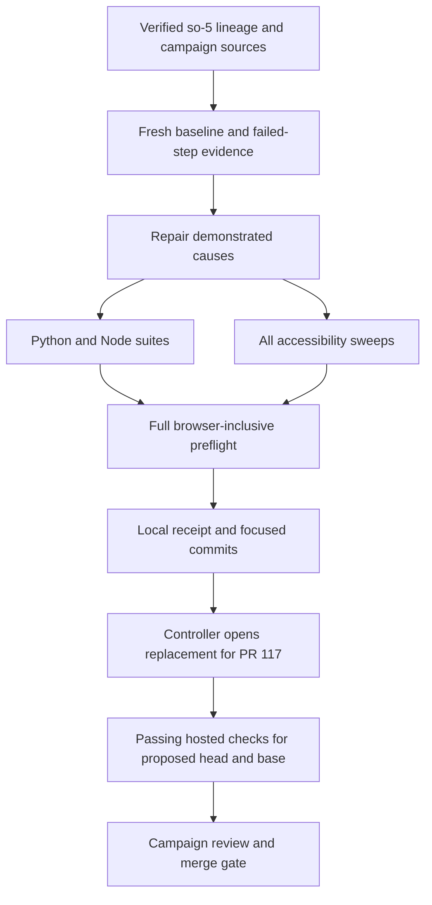

# so-6 Repair Test and Accessibility CI - Plan

## Goal Capsule

- **Objective:** Maintainers can merge changes with passing, trustworthy correctness and accessibility checks, replacing the failed CI proposal in PR #117.
- **Means:** Retain the `so-5` work, reproduce each failed job, and repair its demonstrated cause (KTD1-KTD5).
- **Authority:** The controller's `so-6` mandate and supplied standing rules govern this item. The chief repository's `docs/plans/2026-10-26-0705-feat-codex-drawdown-campaign-plan.md` is authoritative, limited to its Goal Capsule and R11, R15, R16, R17, R19, and R20. Those sections were unavailable in this clone; campaign citations here refer to the supplied mandate, not a verified reading of the chief source.
- **Execution profile:** One item, one branch, one replacement PR: `drawdown/so-6`. This stage commits only this plan. The later build stage uses `lfg`; the controller scans, pushes, and opens the replacement PR, and the campaign gate reviews and merges it (R8).
- **Build prerequisites:** Resolve P1-P2 before implementation. P3 is required for final acceptance. No decision from Damien is currently needed.

---

## Product Contract

### Summary

Repair the Python, Node, and accessibility checks inherited from `so-5`. Preserve their coverage, fix genuine defects exposed by CI, and provide local and hosted evidence that the replacement for PR #117 passes.

### Problem Frame

The controller reports that PR #117's Python tests, Node tests, and Accessibility jobs fail. Its historical local receipt also records incomplete verification. The supplied checkout is newer than that proposal but contains neither its workflow nor its branch ref, so its current state cannot establish the proposal's causes or its ancestry.

### Requirements

**Repair and verification**

- R1. The implementation branch derives from the controller-verified `drawdown/so-5` ref and retains its work; the replacement PR explicitly supersedes #117.
- R2. Repair every failed job using reproduced evidence that distinguishes workflow setup, test-runner defects, stale expectations, and production defects.
- R3. Preserve native unittest discovery, the complete pytest suite, both Node test globs, and execution of the existing assessment-review browser regression.
- R4. Preserve all three accessibility sweeps, their default page/state coverage, existing thresholds, and accepted-WARN policy; all sweeps finish with zero FAIL.
- R5. Every job in the inherited workflow and the repository's full suite pass, with evidence tied to the proposed revision and its actual tested checkout.
- R6. Never delete or weaken an existing test or assertion. Add regression coverage for changed executable behavior, and preserve command failures through logging and report verification.

**Campaign and scope boundaries**

- R7. Work only on `so-6`. Leave the apply daemon, its timer, and normal publishing path unchanged. No spend, credential or security-setting change, message sending, unbacked deletion, force-push, schema migration, data rewrite, package release, or new outside service is part of this repair. Honor the campaign R11 restricted-file rule.
- R8. Commit locally without adding a remote, seeking credentials, or using authenticated GitHub access. Publication, supersession of #117, and hosted acceptance belong to the controller; the Astra and Fable campaign reviews still apply (campaign R15, R17, R19).
- R9. Any frontend fix includes a Playwright screenshot of the changed page committed under `docs/plans/evidence/`, with its path reported as `SCREENSHOT: <path>` (campaign R16).
- R10. Report missing execution capability truthfully. If work ultimately needs something only Damien can supply, use the campaign R20 decision format after completing independent work; a missing or skipped check is not a pass.

### Key Decisions

- **Complete assigned hygiene.** Governs R7. (session-settled: user-directed — chosen over speculative features: the campaign prioritizes durable hygiene when planned work and worthwhile expansions run out.)
- **Keep campaign delivery and model assignments.** Governs R8. (session-settled: user-directed — chosen over the Sol-first local ladder and bypassing cross-model review: local work uses Astra, cloud build stages use Codex Cloud's default model, and cloud PRs retain Astra and Fable review.)

### Scope Boundaries

The repair may change CI configuration, its existing helpers, and the narrow production or test-support code responsible for demonstrated failures. This includes a confirmed frontend defect uncovered by accessibility CI, subject to R6 and R9; the predecessor plan's CI-only scope does not prohibit the repairs expressly authorized by `so-6`.

Other mandate items remain separate. This plan does not close `so-4` live editor verification, perform new editorial work, redesign the site, or change deployment infrastructure.

No new audit engine, broad version matrix, aggregate merge bot, general TAP parser, or blanket retry policy is planned. Existing checks and their process statuses provide the needed boundaries; revisit only a demonstrated failure that those mechanisms cannot represent.

---

## Planning Contract

### Verified Starting State

Inspection on 2026-11-08 was limited to source, Git metadata, and official documentation. No tests, builds, dependency installations, browsers, or runtime probes ran.

| Evidence | Planning consequence |
|---|---|
| Clean `drawdown/so-6` at `9db0204`; no remotes, `main` ref, `drawdown/so-5` ref, or remote-tracking refs | Preserve the supplied branch for this plan commit; P1 must establish the build ancestry. |
| Local unreachable commits `47777d9` and `69f5120` both contain the `so-5` implementation | Their CI patches match, but their base content differs. Neither is independently identified as PR #117's current head. Use them as research evidence only. |
| `47777d9` descends through plan commit `4799eb0` from `dbee3c0`; `69f5120` descends through `25ebf7b` from `09932f7` | A matching patch does not prove which branch history to use. |
| Recovered `.github/workflows/ci.yml` contains Python, Node, and three Accessibility matrix checks | Retain these five visible checks and the existing `pull_request`, `push` to `main`, and `merge_group` events. |
| Recovered `tools/ci/package-lock.json` contains only the root package; both browser install steps use `npm install` | Dependency resolution is not frozen. This is a proven reproducibility defect, not a proven cause of the red jobs. |
| Recovered `tools/ci/verify-node-results.mjs` matches a title substring and rejects SKIP but not TODO | The browser-execution receipt can accept a non-executed or differently named result. Tighten this existing helper without replacing suite exit-status gating. |
| Recovered `docs/plans/evidence/so-5-ci-verification.md` records missing Python dependencies, a semantic-baseline mismatch, and unrun Worker/accessibility checks | The earlier receipt is not a passing baseline; obtain current failed-step logs and reproduce in the build stage. |
| `tools/tests/test_platform_semantic_contract.py` compares a fresh build with `tools/tests/fixtures/platform-semantic-baseline.json` | Older source changes plausibly explain fixture drift; current `9db0204` already includes later fixture updates in `67aa6e9` and `39e71de`. Preserve them during reconciliation. |
| Worker tests require `node:sqlite` and `registerHooks`; recovered CI chooses Node 24 and Python 3.12 | Keep the compatible runtime baseline while diagnosing failures; record exact versions in evidence. |

Recovered-file references above and below mean their contents at `47777d9`, unless a current-checkout path is stated. They are not present in the starting working tree.

The required `docs/plans/2026-10-24-0640-fix-editor-overlay-a11y-plan.md` was read. Its real-page overlays, type modes, locked-focus contrast, and paused-banner coverage inform R4. The named `docs/handoffs/2026-10-23-editorial-review-batch-20261023T172555Z.md`, chief campaign source, and repository `AGENTS.md`/`CLAUDE.md` were absent from available filesystem sources; the editorial handoff is also absent in the recovered `so-5` tree.

### Prerequisites and Remaining Evidence

- P1. **Controller-owned; blocks implementation.** Supply the verified `so-5` local ref and PR #117 head identity. Carry this plan commit onto that lineage while preserving a recoverable record of the supplied `so-6` state. Reconcile later accepted main changes, especially semantic fixtures, through the normal branch process. Record predecessor, source head, and integrated base identities; do not reconstruct the branch from an unverified candidate.
- P2. **Controller-owned; blocks implementation.** Supply or verify the chief Goal Capsule and cited campaign R-IDs, plus the named editorial handoff or an authoritative disposition of its absence. Reconcile any changed constraint without expanding this item.
- P3. **Controller-owned; required before claiming diagnosis and final acceptance.** Supply PR #117's failed-step logs, artifacts, run attempts, tested checkout, and runner details for every failed job family. A fresh baseline may proceed once P1-P2 clear, but unavailable historical logs remain a stated limitation. Final acceptance requires a passing replacement-PR run.

These are source and execution prerequisites, not requests for a new account or Damien's approval. Sandbox socket restrictions may prevent local browser evidence; the controller must run the affected gates in an authorized environment before R5 can be satisfied.

### Assumptions

These defaults remain subject to build-stage evidence:

- Retain the existing hosted-runner allowance, Python 3.12, Node 24, and Puppeteer 24.31.0. No paid runner or dependency upgrade is assumed necessary.
- Preserve legitimate pre-existing optional skips, such as unavailable nginx, with reasons and counts. The mandatory assessment browser regression cannot use those exceptions.
- A complete npm lock and tighter result matching improve existing contracts but may not resolve any reported CI failure; all three job families still need their own diagnosis.

### Key Technical Decisions

- KTD1. **Reproduce before selecting code fixes.** Satisfy R1-R2 by preserving the inherited workflow and recording the first failing step in each family, then any failures it masked. Use the verified predecessor and reconciled target as distinct baselines. Repair demonstrated setup defects in setup and demonstrated behavior defects in their owning code.
- KTD2. **Complete and freeze the existing test dependency graph.** Generate a genuine lockfile for the retained private package and use `npm ci` in both browser-tooling install locations. Preserve disabled lifecycle scripts and explicit browser provisioning. The install must leave the committed manifest and lock unchanged. This repairs R5-R6 reproducibility without changing the production dependency surface. [npm lockfile format](https://docs.npmjs.com/cli/v11/configuring-npm/package-lock-json/), [npm clean installs](https://docs.npmjs.com/cli/v11/commands/npm-ci/).
- KTD3. **Use the pinned browser toolchain through its existing inputs.** Puppeteer 24.31.0 supports CommonJS and has synchronous `executablePath()`; the predecessor plan's v25 async warning does not apply. Invoke the installed package's browser CLI and use its matching browser. Pass a consistent `PUPPETEER_CACHE_DIR` through installation and consumers, rooted under the supplied cache directory in this sandbox. Keep `PUP_DIR`, audit `CHROME_BIN`, headless behavior, and existing launch policy. Add missing OS libraries only if runner evidence requires them. [Tagged manifest](https://raw.githubusercontent.com/puppeteer/puppeteer/puppeteer-v24.31.0/packages/puppeteer/package.json), [tagged browser API](https://raw.githubusercontent.com/puppeteer/puppeteer/puppeteer-v24.31.0/packages/puppeteer-core/src/node/PuppeteerNode.ts), [tagged configuration](https://raw.githubusercontent.com/puppeteer/puppeteer/puppeteer-v24.31.0/packages/puppeteer/src/getConfiguration.ts).
- KTD4. **Preserve assertions while repairing their inputs.** For R2 and R6, review every semantic delta against accepted canonical source changes before updating a fixture. Preserve full equality and mutation canaries; fix an actual generator regression in the generator. For browser-result matching, require the exact named executed success and reject SKIP, TODO, or conflicting target results. Retain support for the existing successful single-result fixture; process exit status remains responsible for overall suite success.
- KTD5. **Keep real accessibility coverage and separate evidence.** For R4-R6, run the default audit with no positional targets and retain each supplemental sweep. Fix measured UI defects in real styles or markup, with regression proof and R9 screenshots. Preserve each sweep's JSON and log before a later local invocation overwrites `build/a11y-audit.json`. Launch and per-page errors need logs even when no complete JSON report exists.
- KTD6. **Accept the actual tested revision.** For R5 and R8, the controller records source head, base, workflow event, tested checkout SHA, run URL, and attempt. Default pull-request checkout tests a synthetic merge commit; prove its relationship to the proposed head/base rather than requiring naive SHA equality. A later change invalidates earlier passing evidence for acceptance. Preserve stable check names and failure-only diagnostics. [GitHub pull-request events](https://docs.github.com/en/actions/reference/workflows-and-actions/events-that-trigger-workflows#pull_request), [workflow logs](https://docs.github.com/en/actions/how-tos/monitor-workflows/use-workflow-run-logs).

### Behavior and Verification Flow

The workflow owns scheduling and job status. `tools/ci/prepare.sh` owns generation and stops at the first failed generator. Each suite owns its exit status; the TAP helper adds proof that the mandatory browser test actually ran. Accessibility exceptions increase the failure count, while logs retain errors omitted from the findings JSON.

### Patterns and Risks

Follow `docs/solutions/orchestration/2026-10-05-fresh-worktree-generated-artifacts-and-legacy-generators.md` for generated prerequisites, verifying the current dependency graph before adding a stage to the existing preparer. Keep ignored bundles untracked and out of uploaded artifacts; do not run the legacy taxonomy generator.

Follow `docs/solutions/editor/2026-07-28-checks-that-cannot-fail.md` for negative proofs and exit-status gating. A passing substring or an absent report cannot prove a successful suite.

Follow `docs/solutions/editor/2026-09-27-css-tokens-defined-only-in-test-stubs.md` for real-style browser proof. The historical headful-only advice in the July harness learning is superseded by the current headless defaults.

The exact Python, Node, and accessibility repair files beyond the confirmed CI helper issues depend on P3 and reproduction. Add a narrowly scoped file only when the receipt connects it to a demonstrated failure. Do not use unknown runtime behavior as permission for broad cleanup or blanket baseline regeneration.

---

## Implementation Units

### U1. Establish the inherited failure baseline

**Goal:** Each repair is tied to a verified source revision and an observed failing step.

**Requirements:** R1-R8, R10; KTD1, KTD6.

**Dependencies:** P1-P2; obtain P3 evidence as available.

**Files:** Inspect `.github/workflows/ci.yml`, `tools/ci/prepare.sh`, `docs/plans/2026-10-27-2133-chore-so-5-test-accessibility-ci-plan.md`, and its existing receipt. Create `docs/plans/evidence/so-6-ci-verification.md` for the build evidence.

**Approach:** Record branch ancestry, current diff, runtimes, runner image, failed steps, and exact local reproduction outcomes. Distinguish the predecessor's failures from any later integration regression. Preserve all inherited workflow changes when reconciling the branch.

**Execution note:** Establish runtime and browser availability before interpreting suite failures. Do not reproduce a hosted check by touching live services.

**Test expectation:** No new executable behavior in this unit. Use the existing suite entry points in the Verification Contract and preserve failed-run output.

**Verification:** The receipt separates observed failures, historical reports, source-inspection findings, and unavailable checks. Each later fix cites its failure and affected requirement.

### U2. Make dependency and browser setup reproducible

**Goal:** A clean runner can install the declared tooling and prepare all suite inputs.

**Requirements:** R2-R6; KTD2-KTD3.

**Dependencies:** U1.

**Files:** `.github/workflows/ci.yml`, `tools/ci/package-lock.json`, and `README.md`. Modify `tools/ci/package.json`, `tools/ci/requirements.txt`, or `tools/ci/prepare.sh` only for a demonstrated prerequisite defect. Preserve and extend `tools/tests/test_ci_prepare.py` if preparer behavior changes.

**Approach:** Complete the existing lock, switch both installs to frozen resolution, and align browser installation and lookup. Preserve full history checkout, the existing generator sequence, and the read-only workflow permissions. A missing generated dependency must be traced before changing preparation.

**Patterns:** Existing `prepare.sh`, `app/worker/scripts/bundle-editor-data.mjs`, and `tools/tests/test_adopter_worker_prerequisites.py`. Preparation unit tests prove ordering and failure propagation, but only a real cold run proves the installed dependencies and browser.

**Test scenarios:**

1. An empty task cache supports clean installation, real preparation, local package loading, and browser launch without host-specific fallback paths.
2. A second clean install leaves the manifest and lock unchanged; a disposable manifest/lock mismatch fails.
3. Existing preparation scenarios still pass from nested paths containing spaces and still stop at each failed generator.
4. A failed package install, browser download, or missing browser stays a failed prerequisite with diagnostics.

**Verification:** The original test dependency baseline installs reproducibly; required generated inputs exist; runtime and managed-browser versions are recorded. No production package or launch-security policy changes.

### U3. Repair Python and Node failures without weakening coverage

**Goal:** Both Python styles and both Node suites pass, with an authentic browser-regression receipt.

**Requirements:** R2-R3, R5-R6; KTD1, KTD4.

**Dependencies:** U2.

**Files:** `tools/ci/verify-node-results.mjs`, `tools/tests/ci_node_results.test.js`; inspect `tools/tests/test_platform_semantic_contract.py`, `tools/tests/fixtures/platform-semantic-baseline.json`, `tools/platform_semantic_contract.py`, and `tools/build_site.py` for the known historical mismatch. Inspect `app/worker/test/assessment-review-browser.test.js` and the failed test's owning source when Node logs identify it. Document any additional narrow file scope in the receipt before editing.

**Approach:** Tighten the existing browser-result matcher using actual Node 24 output. Resolve semantic drift only after reconciling later accepted source and fixture updates. For other failures, add a reproducer in the owning test file and repair the responsible implementation or setup; retain the full existing assertions.

**Patterns:** Semantic equality plus its text/link/order/editor-identity mutation canaries; `tools/tests/ci_node_results.test.js` subprocess fixtures; Worker browser regression using real served assets. Fixture equality catches content drift but does not prove visual accessibility.

**Test scenarios:**

1. The exact target's ordinary successful result passes; failed, skipped, TODO, absent, malformed, substring-only, and conflicting duplicate target results fail. Unrelated skips do not change this result.
2. The reconciled fresh site matches its reviewed semantic fixture; all existing deliberate content and identity mutations remain detectable.
3. Every production or runner repair has a focused regression that fails for the original defect and passes with the fix.
4. A failing Worker command remains a failed job through TAP capture, and a skipped assessment browser regression remains a CI failure even if Node exits zero.

**Verification:** Native unittest, full pytest, tools Node, and Worker Node all pass. The named assessment browser case executes successfully. Any fixture update has an explained field-level diff against accepted source changes.

### U4. Repair and prove all accessibility sweeps

**Goal:** CI measures the intended pages and states, and every sweep finishes with zero FAIL.

**Requirements:** R2, R4-R7, R9-R10; KTD3, KTD5.

**Dependencies:** U2 and U1's failure classification; U3 supplies the shared browser regression proof.

**Files:** `.github/workflows/ci.yml`; inspect `tools/a11y_audit.js`, `tools/platform_browser_matrix.json`, `tools/tests/test_a11y_audit_contract.py`, and `tools/tests/test_platform_browser_matrix.py`. Confirmed page defects may require `site/index.html`, `site/cost-per-credit.html`, `site/brochure.html`, `site/firms.html`, `site/platform/assets/theme.css`, or `app/editor/editor.css`. Update owning generators for generated pages. Add behavioral audit tests in `tools/tests/a11y_audit.test.js` only if audit logic changes, alongside the existing contract tests. Record screenshots under `docs/plans/evidence/so-6-<page>-<viewport>.png` for frontend changes.

**Approach:** Separate browser startup failures from page findings. Preserve the default matrix, both type modes where configured, real editor overlays, locked-focus checks, and paused-banner states. Repair the actual page or audit defect identified by the failed case. Preserve accepted WARN semantics in `docs/uat/accessibility-conformance.md`.

**Patterns:** The 2026-10-24 editor-overlay plan and real-CSS browser regressions. Static contract tests protect coverage wiring; runtime checks prove computed contrast, focus, target geometry, and actual audit exit behavior.

**Test scenarios:**

1. All existing default cases and the cost-per-credit and brochure/firms targets execute successfully after fresh preparation.
2. A disposable failing-page fixture still produces nonzero status; startup failure and nonexistent targets cannot become a pass through logging or artifact upload.
3. A confirmed visual repair passes the original failing case and a Playwright screenshot review at the affected desktop/phone viewport and relevant state.
4. A failed matrix entry does not cancel its siblings; local report collection preserves each invocation separately.

**Verification:** Each sweep reports zero FAIL with inspectable WARN findings. R9 evidence is committed whenever frontend code changes; a tooling-only repair records why screenshots do not apply.

### U5. Verify the whole change and hand off supersession

**Goal:** The controller has enough evidence to replace PR #117 and enforce the existing merge gate.

**Requirements:** R1-R10; KTD6.

**Dependencies:** U3-U4.

**Files:** Complete `docs/plans/evidence/so-6-ci-verification.md` and verify `README.md` against the final commands and dependency setup.

**Approach:** Run the complete Verification Contract on the final integrated tree. Preserve the old `so-5` receipt as historical evidence. Record successful checks, remaining legitimate skips, negative controls, screenshot paths, and any environment limitation. Review the final diff for preserved assertions and scope. The controller creates the replacement PR with a direct #117 supersession reference and records hosted acceptance; the lane does not close the old PR.

**Test expectation:** No new tests for documentation. The full suite, actual hosted checks, and focused regressions validate the assembled repair.

**Verification:** R5 has both local and hosted evidence, the replacement PR identifies the retained predecessor work, and controller review obligations remain intact. Do not mark the item complete with red, missing, cancelled, or mandatory-skipped jobs.

---

## Verification Contract

These are build-stage verification targets, not results from this planning session. Run declared dependency setup and generated-input preparation first. Keep full discovery and distinguish legitimate historical skips from required execution.

| Gate | Entry point or target | Required evidence |
|---|---|---|
| Setup | Inherited `tools/ci/prepare.sh` and repaired frozen dependency install | Cold installation, preserved lock, real bundles, matching browser launch. |
| Python unittest | `python3 -m unittest discover -s tools/tests -p 'test_*.py'` | Complete totals, exit status, and explicit skips. |
| Python full suite | `python3 -m pytest tools/tests/ -q` | TestCase and module-level tests pass, including semantic mutation canaries. |
| Tools Node | `node --test tools/tests/*.test.js` | Full glob passes, including original and added CI-helper cases. |
| Worker Node | `node --test test/*.test.js` from `app/worker/` | Full glob passes; TAP verifier confirms the assessment browser test ran. |
| Default accessibility | `node tools/a11y_audit.js` | Complete default page/state coverage, zero FAIL, preserved report and log. |
| Supplemental accessibility | Existing audit invocations for `site/cost-per-credit.html`, then `site/brochure.html` and `site/firms.html` | Separate reports/logs, zero FAIL; derive file URLs at runtime. |
| Repository full suite | `bash tools/preflight.sh`, including its browser gates | Every gate passes; unavailable local capability remains outstanding until verified by the controller. `--no-browser` does not satisfy this row. |
| Regression and workflow integrity | U2-U4 scenarios plus an Actions-aware workflow linter | Failures propagate; no narrowed globs, weakened assertions, changed protection settings, or hidden missing checks. |
| Frontend evidence | R9 Playwright screenshot(s), when applicable | Actual changed page/state, committed public-safe image, reported path. |
| Hosted replacement PR | Python tests; Node tests; Accessibility (default), (cost-per-credit), (brochure-and-firms) | All five expected checks succeed for the proposed head/base mapping, with run URL and attempt; workflow skips or stale runs do not count. |

Run the normal local full-suite path without live-service overrides. Audit artifact collection must be limited to named, public-safe logs, reports, and screenshots; never upload generated instructor/history bundles wholesale. Keep reports for deliberate failures separate from the passing baseline.

---

## Definition of Done

- P1-P2 are resolved with recorded provenance; P3 limitations are explicit and replaced by current hosted acceptance evidence.
- U1-U5 satisfy their verification outcomes, with every reported failed job traced to its repair.
- All inherited tests and assertions remain intact, and changed executable behavior has regression coverage.
- The complete repository suite and all five expected hosted checks pass for the final proposed change.
- The replacement PR explicitly supersedes #117, retains `so-5`, and proceeds through the controller's normal campaign reviews.
- Frontend changes, if any, carry the required Playwright evidence. No held migration, data rewrite, release, or outside service is introduced.
- The diff contains only the assigned repair, tests, plan, and public-safe evidence; abandoned experiments are absent and unrelated work is preserved.
- This planning stage ends with a focused local commit of this document only. Implementation and execution evidence belong to the later build stage.
