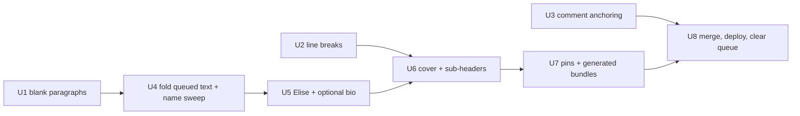

# Editor Queue, November 13–24 Requests - Plan

## Goal Capsule

- **Objective:** Every open row in the editor review queue (31 rows as of 2026-11-24) is applied, declined, or answered, and the home page carries Michael's and Abby's requested changes.
- **Means:** One pull request repairs the editor defects, folds the queued text into canonical data, and builds the new home-page copy. After deploy, admin decisions close every row with a note (KTD3, KTD5).
- **Product authority:**
  - **Damien's answers on 2026-11-24.** Cockpit asks `sonsteng-magnum-opus-2026-11-24-1702-michael-abby-nov-requests` (qids `program-name`, `cover-page`, `skills-subheads`, `elise-editor`) and `sonsteng-magnum-opus-2026-11-24-1714-skills-split-point` (qid `split-point`).
  - **Sources.** The editor review queue (`GET /edit/v1/review`) on 2026-11-24, and the apply daemon's journal for batch `batch-20261124T163201Z`.
  - **Prior plan.** This follows `docs/plans/2026-11-02-1259-feat-john-nov-suggestions-plan.md`, which shipped in PRs #118 and #119.
- **Stop conditions:** Stop and report if any of these happen:
  - A preflight gate fails after three fix attempts.
  - The daemon refuses the merge as diverged.
  - A queue row's `decide` call returns an error that a fresh `GET /edit/v1/review` does not explain.
- **Execution profile:** One PR from a worktree under `~/worktrees/`. The agent merges it from the daemon checkout under the daemon flock (`docs/direct-apply-daemon.md`). The agent also deploys the site and the Worker, clears the queue, and reports evidence. Merge and deploy are authorized under the standing 2026-09-20 authorization.
- **Open blockers:** None. Elise Carlson's bio waits on her (R9).

---

## Product Contract

Product Contract preservation: changed: R11 now ends the first group at "Computer legal research," the sixth skill. Michael's comment said "first 7," but the skill he named is the sixth; Damien chose the named skill on 2026-11-24 (`split-point`).

### Summary

Clear the editor queue that built up after the November 2 plan shipped. Repair the two editor defects behind it: a blanked paragraph blocks its whole batch, and line breaks vanish on the page. Then build Michael's cover page, skills sub-headers, and new editor, and settle the program name.

### Problem Frame

On November 24, Abby merged two intro paragraphs by blanking the second. The schema rejects an empty paragraph, so the validator failed the batch and all three of her edits went to `accepted_blocked`. Editors also keep typing line breaks into headings and paragraphs, and the page collapses them, so the breaks never show. Meanwhile, John and Michael edited from stale pages, which left drifted rows, and Michael's "TEST" probes still sit in the queue.

### Requirements

**Editor defects**

- R1. When an editor blanks a paragraph and the edit is accepted, the paragraph disappears from the page, and the rest of the batch still applies.
- R2. Line breaks an editor types inside a heading or paragraph show on the page.

**Queue clearance**

- R3. Abby's three intro edits (`intro.after_skills` p2, p3, p4) and her latest Authors bio apply as written, with typo and spacing fixes only.
- R4. For each block, the latest substantive edit wins. John's November 19 edit to the Module I "first premise" paragraph and his November 22 edit to the hero's first paragraph ("living document" → "living teaching and learning method") apply with a light touch, and the "TEST" prefix comes out.
- R5. These rows close as declined, each with a one-line note:
  - Michael's "TEST" probes.
  - Edits that differ from live text only by dropped bold or italics.
  - The three companion rows that rename the Minnesota matters m12 and m15 to "Meridian." Those are real-tier Minnesota matters, so the rename runs the wrong way.
- R6. Editorial-flag comments that the current text has already resolved close with a note. Flags that still apply get fixed under R2, R3, or R7.
- R7. Each comment from Abby and Michael gets a reply in the editor. Abby's report that she cannot see edited comments in the side rail gets investigated, and the reply either names the fix or explains what she should expect.

**Home page and authorship**

- R8. "Legal Practicum" becomes the one program name in reader-facing copy. "Legal Practice Practicum" and "Legal Practicum System" leave it, and so does "the System" used as a name. (session-settled: user-directed: chosen over "Legal Practicum System" and "Legal Practice Practicum"; matches the domain, the page title, and the templates)
- R9. Elise Carlson joins as Editor. The byline reads "John Sonsteng and Damien Riehl, with Abby Breit and Elise Carlson, Editors," and the Authors section gives her a card with name and title. A bio follows when she sends one. (session-settled: user-directed: chosen over adding her to the Authors list only, and over waiting for John)
- R10. A full-height cover panel sits above the home-page hero, carrying Michael's three lines: "LEGAL PRACTICUMS," "Law Practice and Law Management PRACTICE READY," and "John Sonsteng and Damien Riehl." (session-settled: user-directed: chosen over replacing the hero eyebrow)
- R11. The "Law practice skills" column shows two sub-headers. The skills through "Computer legal research" (the first six) sit under "Learned through the general law school curriculum," and the rest, starting with "Fact gathering," sit under "Learned through the lawyer's own experience." (session-settled: user-directed: chosen over splitting after the seventh skill, Michael's count, and over asking Michael first)
- R12. Editors can edit the cover lines and sub-headers in the editor, like the rest of the home-page copy.

### Key Flows

- F1. **Editor merges two paragraphs:** Abby folds p4's sentence into p3 and blanks p4. The edit is accepted, the daemon applies it, and the page shows one paragraph where there were two. **Covers R1, R3.**

### Acceptance Examples

- AE1. After deploy, the queue shows no `pending`, `drift`, `needs_human`, or `accepted_blocked` rows from before this work, and a reply sits under each of Abby's and Michael's comments. **Covers R3–R7.**
- AE2. A test batch that blanks one paragraph and edits another applies both edits, and the validator passes. **Covers R1.**
- AE3. A search of reader-facing pages finds no "Legal Practice Practicum" and no "Legal Practicum System." **Covers R8.**
- AE4. On a phone, the cover panel and the skills sub-headers stay readable and pass the existing accessibility audit. **Covers R10, R11.**

### Scope Boundaries

- **Elise's editor access:** Not part of this work. Damien grants editor sign-in separately if she needs one.
- **Colors and fonts:** Planned separately in `docs/plans/2026-11-24-1130-feat-editor-theme-editing-plan.md`.
- **Public repository flip:** Still gated by R12 of the November 2 plan; this work does not change that gate.
- **Drawdown branches** (`drawdown/so-1` through `so-6`): Chief's lane, untouched here.
- **Cover-page byline:** The cover carries Michael's two-name line as written; the editors appear in the byline under R9.
- **Threaded replies:** Not built. Each comment gets one reply, attached when the comment closes (KTD5). Evidence that would change this: editors asking follow-up questions on the same comment.
- **Key deletion in the apply engine:** Not built. A blanked paragraph stays in the data as empty text (KTD1). Evidence that would change this: empty keys accumulating enough to confuse editors or the schema.
- **Line breaks in curriculum Markdown:** Not changed. Markdown blocks keep their existing paragraph rules; R2 covers page-copy text (KTD2).

#### Deferred to Follow-Up Work

- **Abby's email questions** about marketing and the most pressing edits: Damien answers by email. This plan only covers her in-editor comments.

### Outstanding Questions

- **Resolve before planning:** None.
- **Deferred to implementation:**
  - **Rail-visibility cause:** the leading hypothesis is index-shifted comment placement (KTD4). The implementer confirms it by reproducing Abby's view from her editor scope before shipping the fix, and records what they find in the reply to her.

---

## Planning Contract

### Key Technical Decisions

- **KTD1. Blank paragraph = empty value the page skips.**
  - **Schema:** the object branch of `$defs.paragraphs` in `data/schemas/page-copy.schema.json` accepts an empty string. The single-string branch and every other scalar keep `minLength: 1`.
  - **Renderer:** `_copy_paragraphs` in `tools/build_site.py` skips empty members and registers no editor leaf for them.
  - **Why:** the apply engine can already splice a value. Deleting a key would need new structural surgery in `tools/json_surgical.py`. An empty string is still a byte change, so the per-group no-op guard (`docs/solutions/worker/2026-09-27-*`) treats the edit as real. Governs R1.
- **KTD2. Line breaks render through CSS, not markup.**
  - **CSS:** `white-space: pre-line` in `PLATFORM_CSS` (`tools/build_site.py`) on every page-copy text element (each `json_scalar` leaf `_copy_scalar` renders), on every page. These elements print their text with no template indentation inside. Markdown-rendered prose blocks are excluded, because their templates carry indentation whitespace (see Scope Boundaries). The implementer picks the selector, for example a class `_copy_scalar` adds.
  - **Why not ` `:** the editor reads and writes `textContent`, so ` ` would break round-trips. Precedent: `.fact-value { white-space: pre-wrap }`.
  - **Dirty check:** the client marks a leaf dirty when its raw text differs, even if the normalized text matches. That lets an edit that only adds a line break send. The hash contract (`tools/text_norm.py`, client `normalize()`) stays unchanged, so existing `original_hash` values stay valid. Governs R2.
- **KTD3. Queued text is folded into canonical data in the PR, then rows close with notes.**
  - **Pattern:** this mirrors PR #118's handling of John's stuck edits.
  - **Rejected alternative:** re-accepting Abby's blocked rows after deploy. The R8 name sweep rewrites the same p3/p4 text, so her rows would drift anyway, and no admin amend endpoint exists for light-touch fixes. Governs R3, R4.
- **KTD4. Comment bubbles anchor by `source_ref`.**
  - **Placement:** the editor client places a comment by the block whose source reference matches the comment's. It falls back to the stored `page:index` anchor only when no block matches.
  - **Why:** today placement uses the index alone. The November 2 build inserted leaves above older home-page comments, and this plan inserts more (cover, sub-headers, author card), so index placement drifts. That drift is the leading cause of Abby's hidden comments. Governs R7, R12.
- **KTD5. Replies are decline-with-note.**
  - **Mechanism:** `POST /edit/v1/decide` keeps `note` only on decline. Declined comments stay visible, and the client renders "Damien: <note>" under the bubble.
  - **Constraints:** one reply per comment. Notes are short, plain, and in Damien's register, but they are not sent outside the editor.
  - **Notes on edits:** edit rows declined after folding also carry a note ("Applied in PR #<n>"), for the audit trail. Governs R5–R7.
- **KTD6. Skills split is stored by skill id in `data/copy/home.json`.** A sub-header object names the first skill of the second group (Fact gathering), so a reorder of `skills.json` keeps the split meaningful and fails loudly if the id disappears. Governs R11.
- **KTD7. Cover lines are paragraphs, not headings.** `tools/a11y_audit.js` requires exactly one visible h1, and the hero keeps it. The cover is a labeled section with three `
` leaves. For print, the cover takes its own page. Governs R10.
- **KTD8. Author bio becomes optional.** `$defs.person.bio` leaves the required list. The renderer omits the bio paragraph when it is absent or empty. Governs R9.
- **KTD9. Ship order inside the one PR.**
  - **Order:** defects and anchoring first (U1–U3), then content (U4–U6), then regenerated pins (U7).
  - **Queue timing:** clearance runs only after the deploy (U8), so every reply lands against final page indices.

### Sequencing

### Assumptions

- **Queue drift during build:** Abby and Michael may keep editing while this ships. Accepted edits arrive as daemon commits, which U8 step 1 reconciles; rows still open arrive in the queue, which U8 re-reads at clearance time and handles by the same rules (R3–R7). Neither step trusts the 31-row snapshot.
- **Deploy scripts:** `deploy/deploy-dev.sh`, `deploy/deploy-prod.sh`, and the Worker deploy behave as they did for PR #118.

---

## Implementation Units

### U1. Blank paragraph no longer blocks a batch

**Goal:** An accepted blank paragraph applies, validates, and disappears from the page.
**Requirements:** R1, AE2; KTD1.
**Dependencies:** none.
**Files:**
- `data/schemas/page-copy.schema.json`
- `tools/build_site.py` (`_copy_paragraphs`)
- `tools/tests/test_apply_suggestions.py` (or a sibling apply-transaction test file): a real-transaction regression.
- `tools/tests/test_validate_spine.py` (or the schema test home `validate_spine` uses).
**Approach:**
1. Add a paragraph-member definition without `minLength`, and use it only in the object branch of `paragraphs`.
2. Skip empty members in `_copy_paragraphs`, with no editor-map registration.
3. Confirm `coerce_json_scalar` and `splice_scalars` pass an empty string through untouched.
**Execution note:** Write the batch regression first and watch it fail on current `main` for the same reason the daemon logged (`validator_red`).
**Patterns to follow:** existing apply-engine transaction tests in `tools/tests/`; the `$defs` style in `page-copy.schema.json`.
**Test scenarios:**
- Covers AE2. A batch blanks `intro.after_skills.p4` and edits `p3`. Both rows end `applied`, and the validator passes.
- `hero.lede` as a single string set to "" still fails validation, because the scalar branch keeps `minLength`.
- Blanking every member of a paragraphs object still validates (`minProperties` counts keys). The page then renders no paragraph and no empty `
`.
- The rendered home page has no `data-ebsrc` leaf for the blanked key, and the remaining leaves keep their order.
**Verification:** The regression passes, and a local build of home shows one paragraph where p3 and p4 were.

### U2. Typed line breaks show on the page

**Goal:** Line breaks in page-copy text render, and an edit that only adds a break is sendable.
**Requirements:** R2; KTD2.
**Dependencies:** none.
**Files:**
- `tools/build_site.py` (`PLATFORM_CSS`)
- `app/editor/editor.js` (dirty check)
- `app/editor/verify-editor.js` or the editor client test harness, for the browser assertion.
- `tools/tests/test_build_site*.py`, for the CSS presence.
**Approach:**
1. Add `white-space: pre-line` to every page-copy text element per KTD2.
2. In the editor, compare raw `textContent` alongside the normalized text when deciding whether a leaf is dirty. Leave `normalize()` and the hash unchanged.
3. Rebuild the editor bundle (`app/worker/scripts/bundle-editor-data.mjs`) as part of U7.
**Patterns to follow:** `.fact-value` pre-wrap rule; existing dirty-state logic in `editor.js`.
**Test scenarios:**
- `intro.skills_heading` containing "\n" renders as two visual lines. The browser shows a computed height greater than one line box.
- Abby's bio with "\n\n" renders as separated paragraphs inside the bio element.
- A Markdown-rendered curriculum paragraph shows no new blank lines or indentation after the change.
- In the editor, inserting only a line break into a heading marks it dirty and sends a suggestion whose `original_hash` matches the server's.
- An edit with no text change at all (focus, then blur) still sends nothing.
**Verification:** A screenshot of the home intro heading and Abby's bio shows the breaks, and the editor client suite passes headful.

### U3. Comments stay on their own paragraph

**Goal:** Comment bubbles render on the block they were written against, even after new leaves shift page indices.
**Requirements:** R7, R12; KTD4.
**Dependencies:** none.
**Files:**
- `app/editor/editor.js` (`renderPending` comment placement)
- `app/worker/src/editor-map.js` (`projectPendingItems`), if `source_ref` is not already projected to the client.
- The editor client tests (`app/editor/verify-editor.js` / test harness).
- `app/worker/test/` for projection, if changed.
**Approach:**
1. Reproduce Abby's report: load the home page with an `abby`-scoped session against DEV, and record which of her comments are missing or misplaced.
2. Resolve each comment's block by `source_ref` (plus `json_path` for page copy). Fall back to the index anchor only when no block matches.
3. Record the reproduction result for her reply (U8).
**Execution note:** Reproduce before changing code; if the cause is not index drift, fix the actual cause and update KTD4's rationale in the PR description.
**Test scenarios:**
- A comment anchored at `index.html:12` with `source_ref` `data/copy/home.json#hero.eyebrow` renders on the eyebrow after three leaves are inserted above it.
- A comment whose `source_ref` no longer exists renders at its index anchor, unchanged from today's behavior.
- Declined comments with notes render "Damien: <note>" under the bubble on the right block.
**Verification:** In a browser, each of Abby's and Michael's open comments appears beside the text it names, shown in a screenshot.

### U4. Fold the queued text and sweep the program name

**Goal:** Canonical data carries every queued substantive edit and one program name.
**Requirements:** R3, R4, R8, AE3; KTD3.
**Dependencies:** U1, because p4 is blanked or removed.
**Files:**
- `data/copy/home.json`: hero heading, lede p1, `after_skills` p1–p4, and `authors.people.breit.bio`.
- `data/curriculum/m1.md`: the "first premise" paragraph.
- `data/curriculum/templates/engagement-letter-checklist.md`
- `tools/tests/test_platform_language_contract.py`
**Approach:**
1. **Abby's edits:** apply her p2 and p3 text, set p4 to an empty string (KTD1; the key stays), and apply her November 24 bio. Fix only typos and spacing, such as the trailing newline on p2.
2. **John's edits:** apply his November 19 m1 edit (row `687211cd`), with a light touch on the garbled phrases. Keep the paragraph's existing bold and italic emphasis. Apply his November 22 hero p1 wording without the "TEST" prefix.
3. **Name sweep:** search the repo's data, hand-authored site pages, and README case-insensitively for "Legal Practice Practicum," "Practicum System" (which covers "Legal Practicum System" and "The Practicum System"), and "the System" used as the program's name. Replace each with "Legal Practicum," keeping the sentences grammatical. Known hits: the files above, plus "Legal Practicum system" (lowercase) in the m1 paragraph. Record the search result in the PR body, and add any file it finds to this unit.
4. **Guard:** add a case-insensitive forbidden-program-name check to the language contract that matches "Legal Practice Practicum" and "Practicum System," following the existing forbidden-wording helpers, with a mutation canary.
**Patterns to follow:** commit `34ca3d6` (John's stuck edits, light touch); `forbidden_old_wording` in `test_platform_language_contract.py`.
**Test scenarios:**
- Covers AE3. The contract fails when a generated page contains "Legal Practicum System," and the canary proves the check can fail.
- The contract also fails on a lowercase "Legal Practicum system" and on "The Practicum System."
- The contract passes on the rebuilt site.
- The `m1.md` block keeps its `{#b:c6914edd}` anchor, and its rendered text contains "partnerships," not "partmerships."
**Verification:** a case-insensitive search of `site/platform` finds no forbidden variant, and the m1 page renders John's edit.

### U5. Elise Carlson as Editor

**Goal:** Every byline surface names both editors, and Authors shows Elise's card without a bio.
**Requirements:** R9; KTD8.
**Dependencies:** U4, since both edit `home.json`.
**Files:**
- `data/copy/home.json` (`identity.byline`, `authors.people`)
- `data/schemas/page-copy.schema.json` (`$defs.person`)
- `tools/build_site.py` (author card render)
- `README.md`, `CONTENT-LICENSE.md`
- `site/index.html`, `site/brochure.html`, `site/firms.html`
- `tools/tests/test_identity_rights_contract.py` (`COVER_BYLINE`)
- `tools/verify_brochure_firms.js`
**Approach:**
1. Change the byline string everywhere it appears, keeping the pitch's existing `<b>` and `&nbsp;` markup pattern.
2. Add an `authors.people` entry for Elise with name and role "Editor", placed after Abby.
3. Make `bio` optional. Elise's entry omits the `bio` key (no empty string), and the renderer omits the bio element when the key is absent.
**Test scenarios:**
- The identity contract pins the new byline on every shell page, the pitch, and `CONTENT-LICENSE.md`.
- The Authors section renders four cards, and Elise's card has a name and a role but no bio paragraph.
- A person entry with no `bio` key validates and renders with no bio `
`.
- A person entry with `bio: ""` still fails validation (the scalar keeps `minLength: 1`).
**Verification:** The footer, hero byline, pitch, brochure, and firms page all show the new byline in a browser.

### U6. Cover panel and skills sub-headers

**Goal:** The home page opens on Michael's cover, and the skills column carries two editable sub-headers.
**Requirements:** R10, R11, R12, AE4; KTD6, KTD7.
**Dependencies:** U2 (break-aware CSS), U5.
**Files:**
- `data/copy/home.json`: new `cover` object, and sub-header fields with the split skill id under `intro`.
- `data/schemas/page-copy.schema.json`
- `tools/build_site.py`: home body template, `_home_hero_extra` column renderer, `PLATFORM_CSS`.
- `tools/a11y_audit.js` expectations, if needed; `tools/verify_platform_layout.js` (phone matrix).
- `tools/tests/test_build_site*.py`
**Approach:**
1. **Cover:** a labeled cover section before the hero holds three `_copy_scalar` leaves (`cover.*`).
   - **Height:** it fills the viewport below the sticky masthead (`100svh` minus the masthead height, with a `100vh` fallback).
   - **Scroll cue:** it ends in a keyboard-focusable link to the hero.
   - **Type:** lines are left-aligned on the existing display type scale. Their capitalization is stored in the data, so `text-transform` is never used, because editors edit `textContent`.
   - **Tokens and motion:** it reuses existing theme tokens, and any reveal honors `prefers-reduced-motion`.
   - **Print:** the cover takes its own page.
2. **Skills split:** split the law-practice list at the stored skill id into two `<ul>`s, each under an h4 leaf. Both columns keep their h3 headings top-aligned; the sub-headers interrupt only the first column.
3. **Validation:** the build fails if the split id is missing from `skills.json`.
**Patterns to follow:** the hero section markup and the `column()` renderer; theme tokens in `site/platform/assets/theme.css`.
**Test scenarios:**
- Covers AE4. The a11y audit reports 0 FAIL on home, and the cover text passes contrast against its background in production CSS.
- On a 390px-wide viewport, the cover fits without horizontal scroll and the hero follows it.
- The first sub-header's list ends with "Computer legal research," and the second begins with "Fact gathering."
- A split id absent from `skills.json` fails the build with a message that names the field.
- Each cover line and sub-header is an editable leaf in the editor map.
- On a desktop viewport, both column h3 headings share a top edge.
- The cover's scroll link moves keyboard focus to the hero.
**Verification:** Desktop and phone screenshots of the cover and the skills column, inspected.

### U7. Pins and generated bundles

**Goal:** Every count, baseline, and generated bundle matches the new home page, and preflight passes.
**Requirements:** R12; supports all.
**Dependencies:** U1–U6.
**Files:**
- `tools/tests/test_editable_coverage.py`, `tools/tests/test_editor_map_reachability.py` (the `index.html` leaf count)
- `tools/tests/fixtures/platform-semantic-baseline.json`, `tools/tests/test_platform_browser_matrix.py`
- `app/worker/personas/personas.generated.json` and the instructor bundle (regenerated)
**Approach:**
1. Rebuild in the fresh-worktree order from `docs/solutions/orchestration/2026-10-05-*`: build, personas, instructor, history, then the editor bundle.
2. Regenerate semantic baselines with `tools/platform_semantic_contract.py`, never by hand.
3. Update the duplicated pins with a one-line reason.
**Test expectation:** none beyond the suite itself: this unit regenerates fixtures, and its proof is the passing full preflight.
**Verification:** `tools/preflight.sh` passes in full, including the browser legs and `check_build_parity.py`.

### U8. Merge, deploy, and clear the queue

**Goal:** The live site and editor carry the work, and the queue is empty of pre-existing rows, with replies in place.
**Requirements:** R3–R7, AE1; KTD3, KTD5, KTD9.
**Dependencies:** U1–U7 merged.
**Files:** none in the repo, apart from the PR body and handoff evidence.
**Approach:**
1. **Reconcile:** with `DIRECT_APPLY` on, editor edits made during the build land as daemon `apply:` commits on `main`, not as queue rows.
   - **Bring the branch current:** merge current `main` into the branch.
   - **List overlaps:** list the `apply:` commits since the branch point that touch `data/copy/home.json`, `data/curriculum/m1.md`, or the checklist.
   - **Resolve:** for each key they changed, keep the newer editor text (R4), then re-run the name sweep and the guard. Record those commits in the PR body.
2. **Merge:** merge from the daemon checkout under the daemon flock (`docs/direct-apply-daemon.md`), push `main`, and let one daemon tick complete cleanly.
3. **Deploy:** deploy the site to DEV and PROD, and the Worker with the rebuilt editor bundle, as PR #118 did. Verify that the live editor serves the new bundle.
4. **Re-read:** fetch `GET /edit/v1/review` fresh, and classify every row by R3–R7, including rows that arrived during the build.
5. **Decide:** for each row, `decide` with a note: decline folded edits ("Applied in PR #<n>"), decline TEST, emphasis-only, and Meridian rows with their reason, and decline resolved editorial flags.
6. **Reply:** reply to Abby's and Michael's comments by decline-with-note. The note says what changed, or answers the question. Abby's rail reply cites the U3 finding.
7. **Prove empty:** re-fetch the queue and confirm that no pre-existing row remains open.
**Test scenarios:**
- Covers AE1. After clearance, `GET /edit/v1/review` returns no rows created before the merge.
- In a browser with Abby's scope, each of her comments shows the "Damien: …" reply beside the right text.
**Verification:** The queue count before and after, PROD home screenshots on desktop and phone, and the daemon journal showing a clean tick after the merge.

---

## Verification Contract

- **Full preflight:** `tools/preflight.sh` on the head commit, browser legs included. The headful editor suite needs `DISPLAY` and `XAUTHORITY` from the Xwayland process, and up to 1800s.
- **Focused suites:**
  - `python3 -m pytest tools/tests/ -q`
  - `node --test tools/tests/*.test.js`
  - `cd app/worker && node --test test/*.test.js`
- **Accessibility:** `tools/a11y_audit.js` reports 0 FAIL, and the phone layout matrix passes.
- **Absence checks** (the forbidden program name, no blocked rows): each has a planted failure that proves the check can fail.
- **Local CI only:** CI runs locally under the standing no-GitHub-CI rule. The PR body records each command, its counts, and its exit status for the head commit.

## Definition of Done

- **Per unit:** U1–U8 are each verified as stated above.
- **Live site:** PROD home shows the cover, the sub-headers, the new byline, Elise's card, one program name, and visible line breaks, on desktop and phone (screenshots inspected).
- **Queue:** the editor queue holds no pre-existing open rows. Abby and Michael each see a reply under every comment.
- **Cleanup:** the diff carries no abandoned-attempt code, worktrees and dev servers are stopped and removed, and the screenshots are deleted after inspection.
- **Recap:** the final recap lists evidence (commands, counts, exits) and any row that could not close, with its reason.
